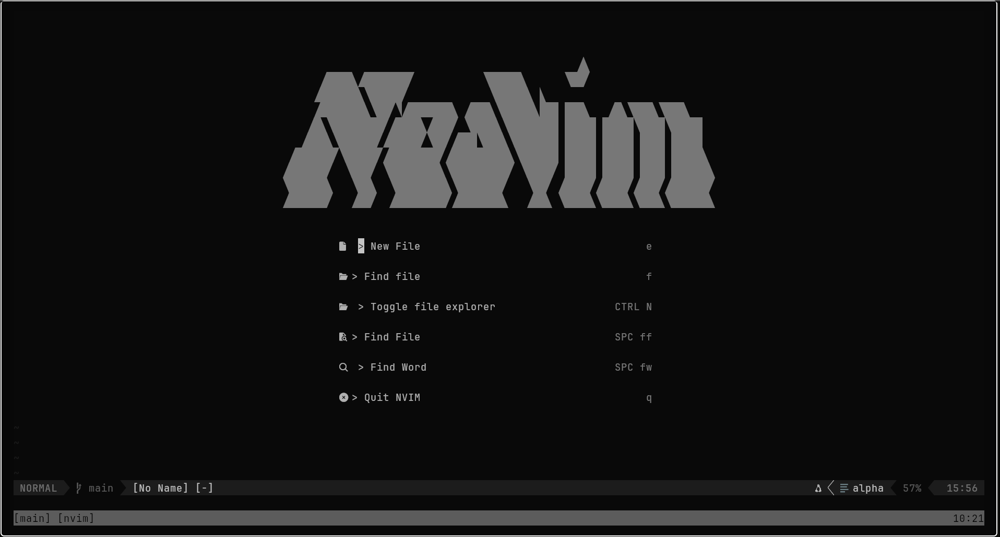
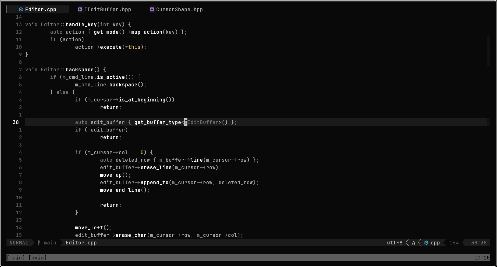
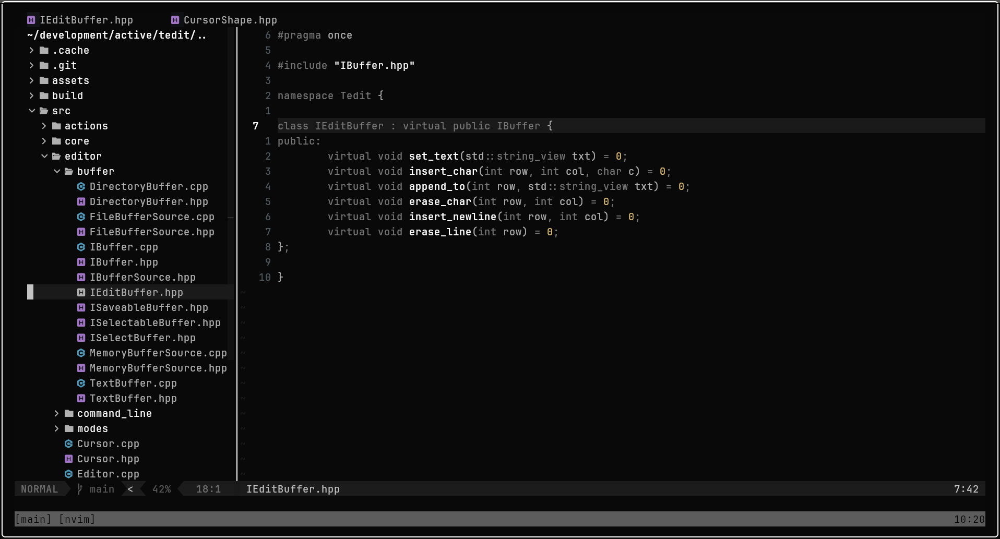
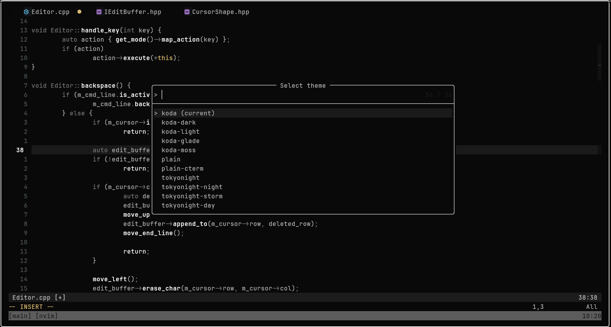
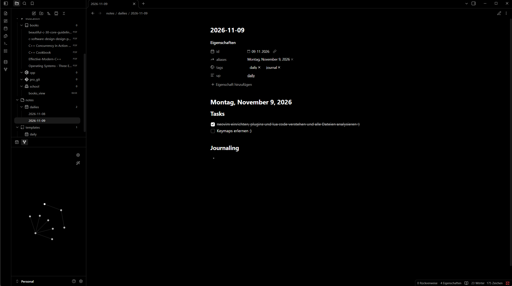

# Salar's Neovim Config configured for Windows

A focused Neovim setup for day-to-day coding, with fast navigation, LSP-backed editing, debugging, file browsing, and a theme workflow that is easy to switch without touching config files.

## Showcase

| Start screen | Code editing |
| --- | --- |
|  |  |

| File tree | Theme picker |
| --- | --- |
|  |  |

| Obsidian.nvim |
| --- |
|  |


## Highlights

- Plugin management through [lazy.nvim](https://github.com/folke/lazy.nvim), bootstrapped automatically on first launch.
- Fuzzy finding, live grep, references, implementations, and diagnostics through Telescope.
- LSP setup for TypeScript, C/C++, Lua, Rust, Typst, Haskell, GDScript, and Godot shader files.
- Completion with `nvim-cmp`, LuaSnip snippets, path suggestions, buffer words, and LSP sources.
- Treesitter highlighting for common web, systems, scripting, markdown, Haskell, and Godot filetypes.
- C/C++/Rust debugging through `nvim-dap`, with LLDB or CodeLLDB auto-detection.
- A custom theme picker with persisted selection and quick next/previous theme commands.
- Practical UI touches: file tree, bufferline, lualine, diagnostics, folds, markdown rendering, and quality-of-life editing plugins.

## Install

Back up your existing config first, then clone this repo into Neovim's config directory:

```sh
git clone <repo-url> ~/.config/nvim
nvim
```

On first launch, `lazy.nvim` installs itself and then installs the configured plugins.

### External tools

Some features work best when these tools are available on your `PATH`:

- `git`, `make`, and a C compiler for native plugin builds.
- Language servers such as `clangd`, `rust-analyzer`, `lua-language-server`, `tinymist`, and `haskell-language-server-wrapper`.
- `lldb-dap` or `codelldb` for debugging C, C++, and Rust.
- `gdshader-lsp` for Godot shader support.

## Keybindings

Leader is `<Space>`.

| Key | Action |
| --- | --- |
| `<leader>ff` | Find files |
| `<leader>fw` | Live grep |
| `<leader>fs` | Document symbols |
| `<leader>fc` | Search word under cursor |
| `<C-n>` | Toggle file tree |
| `<leader>e` | Focus file tree |
| `<Tab>` / `<S-Tab>` | Next / previous buffer |
| `<leader>x` | Close current buffer |
| `<leader>ts` | Select theme |
| `<leader>tn` / `<leader>tp` | Next / previous theme |
| `gd`, `gD`, `gi`, `gt` | LSP navigation |
| `<leader>ca` | Code action |
| `<leader>rn` | Rename symbol |
| `<leader>d` / `<leader>D` | Line / buffer diagnostics |
| `<leader>dc` | Continue debugger |
| `<leader>db` | Toggle breakpoint |
| `<leader>ds`, `<leader>di`, `<leader>do` | Step over / into / out |

## Structure
```text
init.lua                 Entry point
lua/nico/core/          Options, keymaps, theme state, filetype setup
lua/nico/plugins/       Plugin specs
lua/nico/plugins/lsp/   LSP and Mason setup
lua/nico/tools/         Small local helper tools
showcase/                README screenshots
```

--[==[
===============================================================================
NEOVIM KEYBINDINGS REFERENCE
===============================================================================

HOW TO READ THIS LIST
-------------------------------------------------------------------------------
Every line looks like this:

    <leader>od        Open daily note
    ^ the keys        ^ what happens

KEY NOTATION
    <leader>          Space key (set in this file: vim.g.mapleader = " ")
    <C-x>             Hold Ctrl and press X
    <S-x>             Hold Shift and press X
    <A-x>             Hold Alt and press X
    <CR>              Enter
    <Esc>             Escape
    <Tab> / <S-Tab>   Tab / Shift + Tab
    <leader>od        Press Space, then o, then d (one after the other)

MODES (a mapping only works in the mode it was made for)
    n  Normal    v  Visual    i  Insert    t  Terminal    c  Command

WHERE A SHORTCUT COMES FROM (so you know where to change it)
    core/keymaps.lua      This file: general Neovim shortcuts
    plugins/obsidian.lua  Shortcuts that start with <leader>o (plugin keys)
    core/obsidian.lua     Shortcuts inside notes (gf, <CR>, <leader>oc)
                          and shortcuts inside the Telescope picker (<C-x>, <C-l>)

FIND OUT WHAT A KEY DOES
    :map                      List all mappings
    :nmap                     Only Normal Mode mappings
    :verbose nmap <Tab>       Show where <Tab> was defined
    :Telescope keymaps        Search all mappings with a fuzzy finder

IMPORTANT
    Picker shortcuts (section 2) only work INSIDE the Telescope window.
    They do not show up in :map.


PROJECT STRUCTURE
-------------------------------------------------------------------------------

lua/
  core/
    keymaps.lua       General Neovim keybindings
    options.lua       General Neovim settings
    obsidian.lua      Custom Obsidian logic and configuration

  plugins/
    obsidian.lua      Plugin installation, lazy-loading, plugin keymaps and setup
    bufferline.lua    BufferLine plugin configuration


===============================================================================
1. NEOVIM DEFAULT KEYBINDINGS
===============================================================================

MODES
-------------------------------------------------------------------------------
n       Normal Mode       Navigation and commands
i       Insert Mode       Insert text
v       Visual Mode       Select text
V       Visual Line Mode  Select complete lines
<C-v>   Visual Block      Select rectangular text blocks
t       Terminal Mode     Interact with terminal
c       Command Mode      Enter Ex commands


NORMAL MODE - NAVIGATION
-------------------------------------------------------------------------------
h / j / k / l     Move left / down / up / right
w                 Next word
b                 Previous word
e                 End of word
0                 Beginning of line
^                 First non-whitespace character
$                 End of line
gg                First line of file
G                 Last line of file
{ / }             Previous / next paragraph
<C-u>             Scroll half a page up
<C-d>             Scroll half a page down
<C-f>             Scroll one page down
<C-b>             Scroll one page up
zz                Center cursor line vertically


NORMAL MODE - EDITING
-------------------------------------------------------------------------------
i                 Insert before cursor
a                 Insert after cursor
I                 Insert at beginning of line
A                 Insert at end of line
o                 Open new line below
O                 Open new line above
x                 Delete character
dd                Delete line
D                 Delete until end of line
yy                Yank (copy) line
p                 Paste after cursor
P                 Paste before cursor
u                 Undo
<C-r>             Redo
.                 Repeat last change
J                 Join current line with next line
r                 Replace character
ciw               Change inside word
diw               Delete inside word
cw                Change word
dw                Delete word
qw                Start recording a macro into register w ("recording @w")
q                 Stop recording (press q again in Normal Mode)
@w                Play the macro from register w


VISUAL MODE
-------------------------------------------------------------------------------
v                 Enter character-wise Visual Mode
V                 Enter line-wise Visual Mode
<C-v>             Enter block-wise Visual Mode
y                 Copy selection
d                 Delete selection
c                 Change selection
>                 Indent selection
<                 Unindent selection
J                 Move selected lines down (custom below)
K                 Move selected lines up (custom below)


WINDOWS / SPLITS
-------------------------------------------------------------------------------
<C-w>v            Vertical split
<C-w>s            Horizontal split
<C-w>h            Move to left window
<C-w>j            Move to lower window
<C-w>k            Move to upper window
<C-w>l            Move to right window
<C-w>=            Equalize window sizes
<C-w>q            Close current window
<C-w>w            Switch to next window


BUFFERS AND TABS
-------------------------------------------------------------------------------
:ls               List buffers
:bnext            Next buffer
:bprevious        Previous buffer
:bdelete          Delete current buffer
:tabnew           Create new tab
:tabnext          Next tab
:tabprevious      Previous tab
:tabclose         Close current tab


COMMANDS
-------------------------------------------------------------------------------
:w                Save
:q                Quit
:wq               Save and quit
:q!               Quit without saving
:e FILE           Open file
:Ex               Open built-in file explorer
:help             Open help documentation
:map              Show mappings
:nmap             Show Normal Mode mappings
:imap             Show Insert Mode mappings
:tmap             Show Terminal Mode mappings


===============================================================================
2. OBSIDIAN.NVIM KEYBINDINGS
===============================================================================

A) PLUGIN KEYS (plugins/obsidian.lua, Normal Mode, work in any Markdown file)
-------------------------------------------------------------------------------
<leader>od        Open today's daily note
<leader>ob        Show backlinks (which notes link to this one)
<leader>ol        Show links in this note
<leader>oo        Open this note in the Obsidian app
<leader>oq        Quick switch between notes
<leader>os        Search Obsidian notes
<leader>ot        Insert Obsidian template
<leader>oT        Show table of contents


B) NOTE KEYS (core/obsidian.lua, only inside notes of your vault)
-------------------------------------------------------------------------------
gf                Follow Obsidian / Markdown link under cursor
<CR>              Smart action, depends on cursor position:
                    - on a link: follow it
                    - on a checkbox: toggle it
                    - on a heading: toggle fold
<leader>oc        Toggle checkbox ([ ] / [x])


C) PICKER KEYS (core/obsidian.lua, only INSIDE the Telescope window)
-------------------------------------------------------------------------------
Open the list first, e.g. with <leader>oq (notes) or <leader>os (search).

Notes list:
<C-x>             Create a new note
<C-l>             Insert a link to the selected note at the cursor

Tags list:
<C-x>             Tag the current note with the selected tag
<C-l>             Insert the selected tag as text

How to add a link:
  1. Put the cursor where the link should go
  2. <leader>oq
  3. Select the target note with the arrow keys
  4. <C-l>


D) OBSIDIAN COMMANDS (type after :)
-------------------------------------------------------------------------------
:ObsidianToday          Open today's daily note
:ObsidianYesterday      Open yesterday's daily note
:ObsidianTomorrow       Open tomorrow's daily note
:ObsidianDailies        List daily notes
:ObsidianNew            Create a new note
:ObsidianNewFromTemplate  New note from a template
:ObsidianTemplate       Insert a template into the current note
:ObsidianBacklinks      Show backlinks
:ObsidianLinks          Show links in this note
:ObsidianLink           Link selected text to an existing note (Visual Mode)
:ObsidianLinkNew        Link selected text to a new note (Visual Mode)
:ObsidianFollowLink     Follow the link under the cursor
:ObsidianSearch         Search notes
:ObsidianQuickSwitch    Quick switch between notes
:ObsidianTags           List tags
:ObsidianTOC            Table of contents
:ObsidianRename         Rename the current note (updates links)
:ObsidianPasteImg       Paste an image from the clipboard
:ObsidianToggleCheckbox Toggle checkbox
:ObsidianOpen           Open in the Obsidian app

If a command says "Not an editor command", your plugin version may use
the newer style, for example ":Obsidian today". Type ":Obsidian" and press
Tab to see the available sub-commands.


Other Obsidian helpers
-------------------------------------------------------------------------------
[[                Type two square brackets and a note name: nvim-cmp
                  suggests matching notes (Insert Mode)


===============================================================================
3. YOUR CUSTOM NEOVIM KEYBINDINGS
===============================================================================

LEADER KEY
-------------------------------------------------------------------------------
<leader>          Space (" ")

WINDOW MANAGEMENT
-------------------------------------------------------------------------------
<leader>sv        Split window vertically
<leader>sh        Split window horizontally
<leader>se        Make splits equal size
<leader>sx        Close current split

<C-Up>            Increase window height
<C-Down>          Decrease window height
<C-Left>          Decrease window width
<C-Right>         Increase window width


BUFFER MANAGEMENT
-------------------------------------------------------------------------------
<Tab>             Switch to next buffer
<S-Tab>           Switch to previous buffer
<leader>x         Close current buffer
<leader>n         Create new tab


SCROLLING
-------------------------------------------------------------------------------
<C-u>             Scroll half page up and center cursor
<C-d>             Scroll half page down and center cursor


VISUAL MODE
-------------------------------------------------------------------------------
J                 Move selected lines down
K                 Move selected lines up


FILE EXPLORER
-------------------------------------------------------------------------------
<C-n>             Open built-in file explorer (:Ex)


LSP / TELESCOPE
-------------------------------------------------------------------------------
<leader>ci        Show incoming calls
<leader>co        Show outgoing calls
<leader>ch        Show implementations
<leader>cu        Show references


THEME MANAGEMENT
-------------------------------------------------------------------------------
<leader>ts        Select theme
<leader>tn        Next theme
<leader>tp        Previous theme


TERMINAL
-------------------------------------------------------------------------------
<Esc>             Exit Terminal Mode and return to Normal Mode
                  (Terminal remains running)

i                 Return to Terminal Mode from Normal Mode


===============================================================================
4. IMPORTANT INFORMATION
===============================================================================

Example:
keymap.set("n", "<Tab>", ...)
The mapping only works in Normal Mode.

Some keybindings are defined directly in plugin configuration files.
They do not all have to be inside core/keymaps.lua.

===============================================================================
]==]


-- ============================================================================
-- GENERAL CONFIGURATION
-- ============================================================================

vim.g.mapleader = " "

local keymap = vim.keymap


-- ============================================================================
-- SCROLLING
-- ============================================================================

keymap.set("n", "<C-u>", "<C-u>zz")
keymap.set("n", "<C-d>", "<C-d>zz")


-- ============================================================================
-- WINDOW MANAGEMENT
-- ============================================================================

keymap.set("n", "<leader>sv", "<C-w>v", { desc = "Split window vertically" })
keymap.set("n", "<leader>sh", "<C-w>s", { desc = "Split window horizontally" })
keymap.set("n", "<leader>se", "<C-w>=", { desc = "Make splits equal size" })
keymap.set("n", "<leader>sx", "<cmd>close<CR>", { desc = "Close current split" })

keymap.set("n", "<C-Up>", "<cmd>resize +2<CR>", { desc = "Increase height" })
keymap.set("n", "<C-Down>", "<cmd>resize -2<CR>", { desc = "Decrease height" })
keymap.set("n", "<C-Left>", "<cmd>vertical resize -4<CR>", { desc = "Narrower" })
keymap.set("n", "<C-Right>", "<cmd>vertical resize +4<CR>", { desc = "Wider" })


-- ============================================================================
-- BUFFER AND TAB MANAGEMENT
-- ============================================================================

keymap.set("n", "<Tab>", "<cmd>BufferLineCycleNext<CR>", { desc = "Go to next buffer" })
keymap.set("n", "<S-Tab>", "<cmd>BufferLineCyclePrev<CR>", { desc = "Go to previous buffer" })

keymap.set("n", "<leader>x", "<cmd>bdelete<CR>", { desc = "Close current buffer" })
keymap.set("n", "<leader>n", "<cmd>tabnew<CR>", { desc = "New tab" })


-- ============================================================================
-- VISUAL MODE
-- ============================================================================

keymap.set("v", "J", ":m '>+1<CR>gv=gv")
keymap.set("v", "K", ":m '<-2<CR>gv=gv")


-- ============================================================================
-- FILE EXPLORER
-- ============================================================================

keymap.set("n", "<C-n>", "<cmd>Ex<CR>", { desc = "Open file explorer" })


-- ============================================================================
-- LSP / TELESCOPE
-- ============================================================================

keymap.set("n", "<leader>ci", "<cmd>Telescope lsp_incoming_calls<CR>", { desc = "Incoming calls" })
keymap.set("n", "<leader>co", "<cmd>Telescope lsp_outgoing_calls<CR>", { desc = "Outgoing calls" })
keymap.set("n", "<leader>ch", "<cmd>Telescope lsp_implementations<CR>", { desc = "Implementations" })
keymap.set("n", "<leader>cu", "<cmd>Telescope lsp_references<CR>", { desc = "References" })


-- ============================================================================
-- THEME MANAGEMENT
-- ============================================================================

keymap.set("n", "<leader>ts", "<cmd>Theme<CR>", { desc = "Select theme" })
keymap.set("n", "<leader>tn", "<cmd>ThemeNext<CR>", { desc = "Next theme" })
keymap.set("n", "<leader>tp", "<cmd>ThemePrev<CR>", { desc = "Previous theme" })


-- ============================================================================
-- TERMINAL
-- ============================================================================

keymap.set("t", "<Esc>", [[<C-\><C-n>]], { desc = "Exit terminal mode" })
